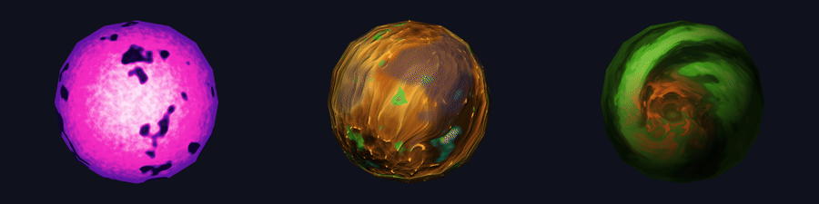
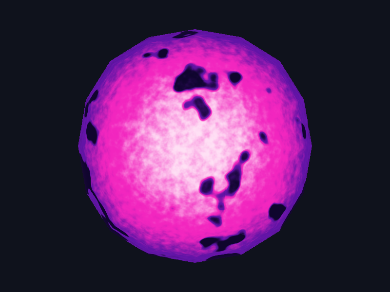
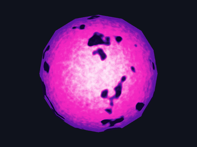
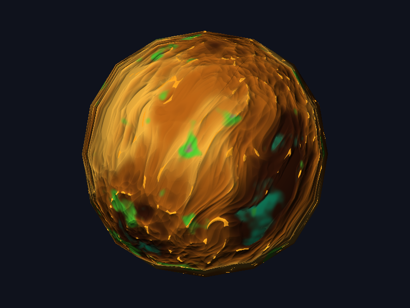
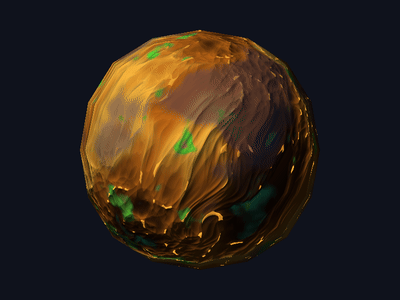
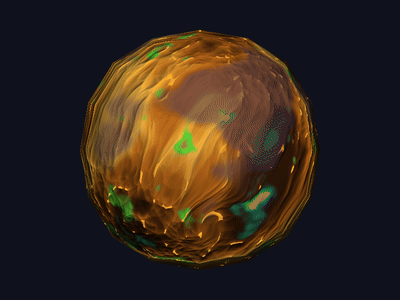
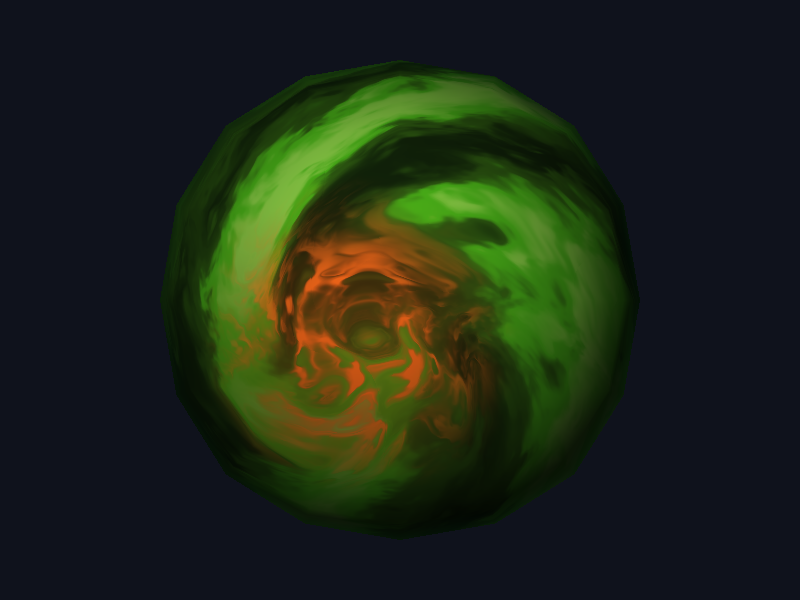
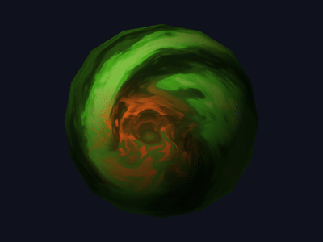

# Lab 6: Shaders procedurales

Entrega del laboratorio de Gráficas por Computadora. El proyecto renderiza una
misma esfera `.obj` en CPU, sin GPU ni texturas externas. La apariencia de cada
cuerpo celeste se genera únicamente en sus fragment shaders, con ruido
OpenSimplex/Fbm, normales, posición, tiempo y luz.

Este laboratorio continúa el renderer por software de los laboratorios
anteriores (ver el README del Lab 5: rasterización de triángulos).


<!-- TODO: docs/gifs/demo.gif -> montaje de los tres cuerpos (o solo la estrella) -->

## Requisitos

- Rust y Cargo instalados.
- Herramientas de compilación de C y CMake para `raylib-sys`.
- El proyecto se ejecuta con el renderer de CPU incluido; no requiere una GPU.
- Opcional, solo para regenerar los GIFs: `ffmpeg`.

## Compilación y ejecución

Para abrir el modo interactivo:

```bash
cargo run --release
```

También se puede renderizar un único frame sin abrir la ventana. El modo
headless recibe el shader (`1`, `2` o `3`), la vista, la luz, el tiempo y la ruta
de salida. Por ejemplo:

```bash
cargo run --offline --release -- \
  --shader 2 \
  --view color \
  --light -0.45,-0.56,-0.70 \
  --time 0.0 \
  --out captures/auto/zebes.png
```

Las vistas válidas son `height`/`altura`, `biome`/`bioma`, `cracks`/`grietas` y
`color`. El PNG se escribe en la ruta indicada y el proceso termina.

Para ejecutar las pruebas:

```bash
cargo test --offline
```

## Controles

| Tecla | Acción |
|---|---|
| `1` | Selecciona la estrella. |
| `2` | Selecciona Zebes. |
| `3` | Selecciona Adrian. |
| `B` | Modo de triángulos rellenos con barycentrics. |
| `W` | Modo wireframe. |
| `V` | Cicla las vistas de Zebes: altura, bioma, grietas y color. |
| `D` | Activa/desactiva la vista global de FBM en escala de grises. |
| `[` / `]` | Disminuye/aumenta la frecuencia de la vista `D`. |
| `J` / `L` | Rota la dirección de la luz hacia la izquierda/derecha. |
| `P` | Guarda una captura incremental en `captures/shot_NNN.png`. |

Las flechas también rotan la cámara y la rueda del mouse ajusta el zoom.

## Pipeline de shading

```text
Archivo sphere.obj (98 vértices, 192 triángulos)
    ↓
Vertex shader: posición y normal a espacio mundo (uniforms.model)
    ↓
Rasterización con z-buffer (menor z = fragmento más cercano)
    ↓
Interpolación barycéntrica: object_pos, world_pos, normal, profundidad
    ↓
Fragment shader por cuerpo (star.rs, rocky.rs, gas_giant.rs)
    usa: noise.rs, tiempo, light_dir, camera_pos
    ↓
Framebuffer 800x600
    ↓
Ventana o exportación PNG (P o modo headless)
```

Los tres cuerpos usan **exactamente la misma geometría**: no se modifican
vértices ni se agregan modelos. `src/shaders.rs` solo despacha según la tecla
seleccionada y contiene los helpers de iluminación comunes (`diffuse_factor`,
`surface_mu`).

**Convención de normal y vista:** el z-buffer usa menor `z` como más cercano y la
cámara está en `+z`, por lo que la normal visible queda invertida respecto al
vector de vista. Los helpers comunes lo compensan (por eso `surface_mu` usa
`abs(dot(normal, view))`) y la convención está comentada en el código.

## Cuerpos celestes

### Nyxara, estrella violeta/magenta

<!-- TODO: cambiar "Nyxara" por el nombre final elegido -->



**Captura:** `docs/captures/estrella.png`.

**Animación:**


<!-- TODO: docs/gifs/estrella.gif (~4 s, loop): hervor de la granulación y pulso -->

El shader está en `src/shaders/star.rs`. Es una superficie emisiva: no usa
`light_dir`. `temperature` combina el oscurecimiento hacia el limbo mediante
`surface_mu`, granulación animada con `noise::fbm4` y manchas de baja frecuencia
que restan temperatura en zonas aisladas. `shade` convierte esa temperatura en
una paleta que pasa suavemente por índigo, violeta, magenta y blanco rosado;
después suma la corona (fresnel) y un pulso global sutil.

La granulación y las manchas usan ruido 4D con `time` como cuarta coordenada, a
velocidades independientes: el grano "hierve" sin deslizarse sobre la esfera y
las manchas evolucionan más despacio.

| Constante | Qué cambia visualmente |
|---|---|
| `GRANULATION_FREQ` | Escala espacial del grano superficial. |
| `GRANULATION_SPEED` | Velocidad del hervor de la granulación. |
| `GRANULATION_AMP` | Contraste del grano. |
| `SPOT_FREQ` | Tamaño y distribución de las manchas. |
| `SPOT_SPEED` | Velocidad independiente de las manchas. |
| `SPOT_THRESHOLD` | Cantidad de superficie que entra en las manchas. |
| `SPOT_SOFTNESS` | Suavidad de la penumbra de las manchas. |
| `LIMB_EXPONENT` | Fuerza del oscurecimiento del borde. |
| `CORONA_EXPONENT` | Qué tan concentrado queda el halo en el borde. |
| `CORONA_INTENSITY` | Brillo de la corona rosado-magenta. |
| `PULSE_AMP` / `PULSE_SPEED` | Amplitud y velocidad del pulso de brillo. |

La paleta se define con `PALETTE_WHITE_PINK`, `PALETTE_MAGENTA`,
`PALETTE_VIOLET` y `PALETTE_INDIGO`.

### Zebes, planeta rocoso inspirado en Metroid



**Capturas:** `docs/captures/zebes_frontal.png` y
`docs/captures/zebes_noche.png`.

**Animaciones:**

| Nubes con movimiento independiente | Luz rotando (lava, especular y bump) |
|:---:|:---:|
|  |  |

<!-- TODO: docs/gifs/zebes_nubes.gif (time 0 -> ~40) y docs/gifs/zebes_luz.gif (luz de lado a lado) -->

El shader está en `src/shaders/rocky.rs`. Es un mundo de roca ámbar/dorada con
vetas finas y fluidas, remolinos pequeños, y pequeños acentos de otras regiones
del planeta:

- `height_field` genera la roca con `ridged` estirado en una dirección diagonal
  (`VEIN_ANGLE`, `VEIN_STRETCH`), domain warp y tres remolinos locales
  (`SWIRL_*`).
- `biome_mask` marca pequeños parches de vegetación verde tóxica (Brinstar).
- `crack_mask` marca las grietas finas de lava (Norfair).
- El mar ácido (Maridia) aparece en las zonas más bajas del campo de altura,
  controlado por `SEA_LEVEL`.
- `surface_color` combina la paleta cálida con esas máscaras.
- `bumped_normal` calcula el gradiente de `height_field` por diferencias finitas
  y perturba la normal.
- `lit_surface_color` aplica la difusa; el mar recibe un especular Blinn-Phong y
  la roca permanece mate.
- `shade` suma la lava nocturna y mezcla las nubes (`cloud_mask`,
  `lit_cloud_color`).

| Constante | Qué cambia visualmente |
|---|---|
| `VEIN_STRETCH` | Longitud de las vetas. |
| `VEIN_ANGLE` | Rotación diagonal del eje de estiramiento. |
| `WARP_AMP` / `WARP_FREQ` | Curvatura y escala del domain warp. |
| `RIDGE_SHARPNESS` | Finura y contraste de las crestas. |
| `SWIRL_CENTERS` / `SWIRL_STRENGTH` / `SWIRL_RADIUS` | Posición, fuerza y tamaño de los remolinos. |
| `BIOME_THRESHOLD` | Cobertura del bioma verde. |
| `CRACK_THRESHOLD` | Cantidad de grietas de lava. |
| `SEA_LEVEL` | Cobertura del mar ácido. |
| `BUMP_STRENGTH` / `BUMP_DELTA` | Intensidad y escala del relieve. |
| `SEA_SPEC_POWER` / `SEA_SPEC_STRENGTH` | Tamaño e intensidad del reflejo del mar. |
| `LAVA_GLOW` | Brillo emisivo de las grietas en el lado nocturno. |
| `CLOUD_FREQ` / `CLOUD_COVERAGE` | Tamaño y cobertura de las nubes. |
| `CLOUD_SPEED` / `CLOUD_OPACITY` | Movimiento y opacidad de las nubes. |
| `AMBIENT` | Qué tan oscuro es el lado no iluminado. |

### Adrian, mundo denso inspirado en *Project Hail Mary*



**Capturas:** `docs/captures/adrian_t000.png`,
`docs/captures/adrian_t030.png` y `docs/captures/adrian_lateral.png`.

**Animación:**


<!-- TODO: docs/gifs/adrian.gif (~5 s): flujo de bandas y vórtice girando -->

El shader vive en `src/shaders/gas_giant.rs`. La interpretación visual es
Adrian como un mundo denso de aspecto verde y arremolinado, no como un gigante
gaseoso literal; lo que se explora es el aspecto de bandas con transiciones
líquidas que pide el laboratorio.

`domain_warp` aplica tres pasadas de warp (frecuencia media, alta y muy alta con
amplitud decreciente) y `band_pattern_at` mezcla la latitud distorsionada con
FBM para producir un marmoleado que se siente líquido. `vortex_domain` rota las
coordenadas alrededor del centro de la tormenta con un decaimiento exponencial
que afecta a todo el patrón vecino: las bandas se enrollan en espiral hacia el
vórtice. `vortex_mask` define el parche naranja-rojizo con un borde orgánico
perturbado por ruido. `surface_color` mezcla la paleta verde con ese parche y
`shade` aplica luz, oscurecimiento de limbo y rim atmosférico.

Con ruido 4D, las capas del warp se mueven a velocidades distintas y el vórtice
gira despacio, de modo que el patrón fluye en lugar de desplazarse rígidamente.

| Constante | Qué cambia visualmente |
|---|---|
| `BAND_FREQ` | Cantidad de bandas principales. |
| `WARP1_AMP` / `WARP2_AMP` / `WARP3_AMP` | Intensidad de la turbulencia líquida. |
| `WARP1_FREQ` / `WARP2_FREQ` / `WARP3_FREQ` | Escala de cada detalle del warp. |
| `WARP1_SPEED` / `WARP2_SPEED` | Velocidad independiente del flujo. |
| `VORTEX_CENTER` | Posición del parche naranja. |
| `VORTEX_RADIUS` | Tamaño del parche de tormenta. |
| `VORTEX_INFLUENCE_RADIUS` | Alcance de la curvatura de las bandas vecinas. |
| `VORTEX_STRENGTH` | Intensidad del enrollamiento. |
| `VORTEX_EDGE_NOISE` | Irregularidad del borde del vórtice. |
| `VORTEX_SPIN` | Velocidad de rotación del vórtice. |
| `AMBIENT` | Qué tan oscuro es el lado no iluminado. |

## Efectos evaluables

| Efecto | Cuerpo | Archivo y función | Evidencia | Parámetro modificable |
|---|---|---|---|---|
| Material animado | Estrella (principal) y Adrian (complemento) | `src/shaders/star.rs`, `temperature` y `shade`; `src/shaders/gas_giant.rs`, `domain_warp` y `shade` | `docs/gifs/estrella.gif`, `docs/gifs/adrian.gif` | `GRANULATION_SPEED`: acelera el hervor de la estrella. `WARP1_SPEED`/`WARP2_SPEED`: cambian el flujo de Adrian. |
| Respuestas diferentes a la luz | Zebes | `src/shaders/rocky.rs`, `lit_surface_color`; iluminación común en `src/shaders.rs`, `diffuse_factor` | `docs/gifs/zebes_luz.gif`, `docs/captures/zebes_frontal.png` | `SEA_SPEC_POWER`: reflejo del mar más amplio o concentrado; la roca se mantiene mate. |
| Día y noche | Zebes | `src/shaders/rocky.rs`, `lit_surface_color` y `shade` | `docs/gifs/zebes_luz.gif`, `docs/captures/zebes_noche.png` | `LAVA_GLOW`: aumenta la emisión de las grietas en el lado nocturno. |
| Nubes procedurales | Zebes | `src/shaders/rocky.rs`, `cloud_mask`, `lit_cloud_color` y `shade` | `docs/gifs/zebes_nubes.gif`, `docs/captures/zebes_nubes_t000.png`, `docs/captures/zebes_nubes_t020.png` | `CLOUD_COVERAGE`: cobertura de las nubes. `CLOUD_SPEED`: velocidad independiente del terreno. |
| Bump mapping | Zebes | `src/shaders/rocky.rs`, `bumped_normal` | `docs/gifs/zebes_luz.gif`, `docs/captures/zebes_frontal.png` | `BUMP_STRENGTH`: refuerza o suaviza el relieve que responde a la luz. |
| Tormenta o vórtice | Adrian | `src/shaders/gas_giant.rs`, `vortex_domain` y `vortex_mask` | `docs/captures/adrian_t000.png`, `docs/captures/adrian_lateral.png`, `docs/gifs/adrian.gif` | `VORTEX_STRENGTH`: enrollamiento de las bandas. `VORTEX_RADIUS`: tamaño del parche. |

**Notas de puntuación:**

- El movimiento de las nubes de Zebes puntúa únicamente como *nubes
  procedurales*; no se reclama además como material animado. Para *material
  animado* se presenta la superficie de la estrella (evidencia principal) y el
  flujo atmosférico de Adrian (complemento).
- El especular del mar y la roca mate puntúan como *respuestas diferentes a la
  luz*; la lava que solo brilla de noche puntúa como *día y noche*. Son
  comportamientos distintos y no se cuentan dos veces.
- El vórtice de Adrian deforma las bandas vecinas mediante `vortex_domain`; no
  es solo un círculo de otro color.

## Rendimiento

Tiempo por frame en CPU, build release, framebuffer de `800x600`. CPU:
**<TU CPU>**.

| Shader | Tiempo por frame | Octavas de FBM |
|---|---:|---|
| Estrella | <X ms> | 3 (4D) |
| Zebes | <X ms> | <N> |
| Adrian | <X ms> | <N> |

Como el renderer es de CPU, el costo está dominado por las octavas de ruido por
fragmento: por eso cada campo usa 3-4 octavas como máximo.

## Cómo regenerar los GIFs

Con el modo headless no hace falta grabar pantalla: se renderizan frames con
distinto `--time` o `--light` y se unen con `ffmpeg`. Los frames quedan en
`captures/auto/`, ignorada por Git.

```bash
mkdir -p captures/auto/frames docs/gifs
for i in $(seq 0 59); do
  t=$(awk "BEGIN{print $i*0.1}")
  ./target/release/lab6 --shader 1 --view color \
    --light -0.45,-0.56,-0.70 --time $t \
    --out captures/auto/frames/star_$(printf %03d $i).png
done
ffmpeg -y -framerate 15 -i captures/auto/frames/star_%03d.png \
  -vf "scale=400:-1:flags=lanczos,split[a][b];[a]palettegen[p];[b][p]paletteuse" \
  docs/gifs/estrella.gif
```

- **Nubes de Zebes:** `--shader 2` con paso de tiempo `0.7`.
- **Luz de Zebes:** `--time` fijo y `--light $x,-0.3,-0.5` con
  `x=$(awk "BEGIN{print -0.9+$i*0.03}")`.
- **Adrian:** `--shader 3` con `time` de 0 a 30.

(Ajustá el nombre del binario en `target/release/` al de tu crate.)

## Estructura del proyecto

```text
lab6-graficas/
├── Cargo.toml
├── Cargo.lock
├── .gitignore
├── assets/
│   └── sphere.obj
├── src/
│   ├── main.rs
│   ├── obj.rs
│   ├── vertex.rs
│   ├── fragment.rs
│   ├── triangle.rs
│   ├── rasterizer.rs
│   ├── framebuffer.rs
│   ├── primitive.rs
│   ├── scene.rs
│   ├── noise.rs
│   ├── shaders.rs
│   └── shaders/
│       ├── star.rs
│       ├── rocky.rs
│       └── gas_giant.rs
├── docs/
│   ├── captures/
│   └── reference/
│       └── adrian.png
├── captures/
│   ├── auto/
│   ├── shot_001.png
│   └── shot_002.png
└── README.md
```

## Limitaciones conocidas

- La esfera proporcionada tiene 98 vértices y una silueta facetada; los
  shaders no modifican la malla ni agregan modelos.
- El renderer es de CPU, por lo que aumentar demasiado las octavas de ruido
  reduce el framerate.
- Adrian se interpreta como un mundo denso inspirado en el libro, no como un
  gigante gaseoso físicamente exacto.
- Las capturas de `captures/auto/` son artefactos de trabajo y no forman parte
  de la evidencia versionada; las evidencias estables están bajo `docs/`.

## Dependencias principales

- [`raylib`](https://crates.io/crates/raylib): ventana, imagen y presentación
  del framebuffer. No se usa para cargar ni dibujar modelos 3D.
- [`noise`](https://crates.io/crates/noise) 0.9: OpenSimplex y Fbm 3D/4D.

## Autor

**Marcelo Detlefsen** - Carné 24554  
*Universidad del Valle de Guatemala*  
*Gráficas por Computadora - Laboratorio 6*
