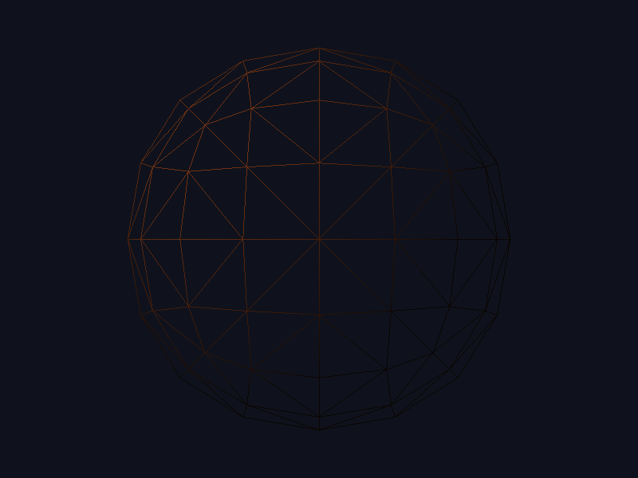
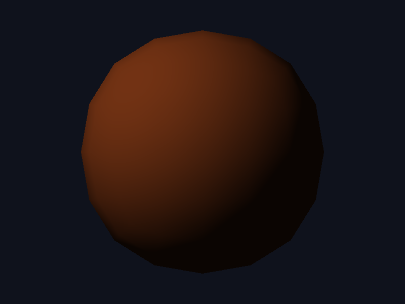

# lab6-graficas

## Capturas

Presioná `W` para wireframe, `B` para relleno barycéntrico y `P` para guardar
la vista actual en `captures/shot_NNN.png`.

### Wireframe (`W`)

### Relleno barycéntrico (`B`)

